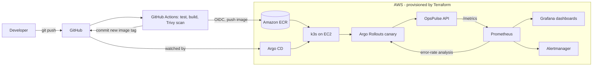

# OpsPulse

A production-style delivery platform on AWS: **Terraform** builds the infrastructure, **GitHub Actions** tests, scans and ships the image, **Argo CD** deploys it from Git, and **Argo Rollouts** runs a canary that **rolls back automatically** when the error rate rises. **Prometheus and Grafana** provide SLO-based monitoring.

## Why this project
It demonstrates the full path from a commit to a monitored, self-protecting release: infrastructure as code, CI/CD, GitOps, observability, progressive delivery and basic security hygiene.

## Architecture

## Repository layout
| Path | Purpose |
|---|---|
| `app/` | FastAPI service with Prometheus metrics, tests and Dockerfile |
| `infra/bootstrap/` | One-time remote state (S3 + DynamoDB) |
| `infra/modules/` | Reusable modules: `vpc`, `ecr`, `k3s_node` |
| `infra/envs/dev/` | Dev environment and GitHub OIDC role |
| `gitops/` | Argo CD application and Kubernetes manifests |
| `monitoring/` | Prometheus/Grafana Helm values |
| `.github/workflows/` | CI pipeline and Terraform checks |
| `docs/` | PRD, build guide, interview story |

## Quick start
1. `make test` runs the unit tests locally.
2. Follow `docs/BUILD_GUIDE.md` week by week. Start with `make tf-bootstrap`.
3. Demo: set `FAIL_RATE` to `"0.5"` in `gitops/apps/opspulse/rollout.yaml`, push, run `scripts/loadgen.sh`, and watch the canary abort.
4. Clean up: `make tf-destroy` (important for cost).

## Reliability targets (SLOs)
99.5% availability and p95 latency under 300 ms, measured by Prometheus and alerted on.

## Known trade-offs
Single-node k3s (not highly available) and public subnets without NAT keep the cost low. A production version would use multi-AZ EKS and private subnets.

## Results (will be  filled in after my demo)
- Commit to live: ___ min | Rollback time: ___ s | Environment build time: ___ min
